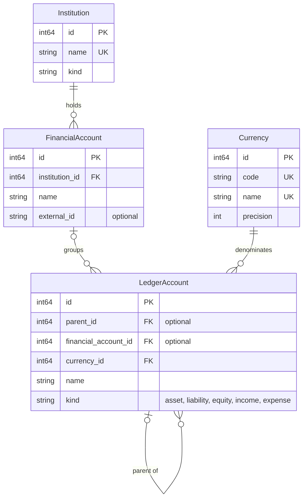
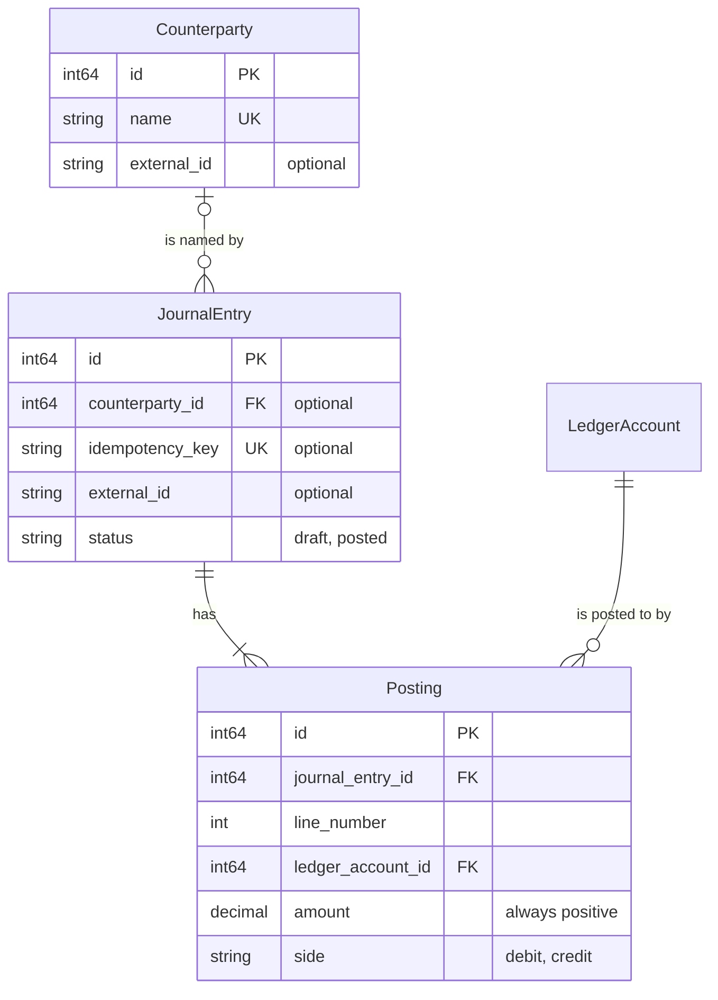
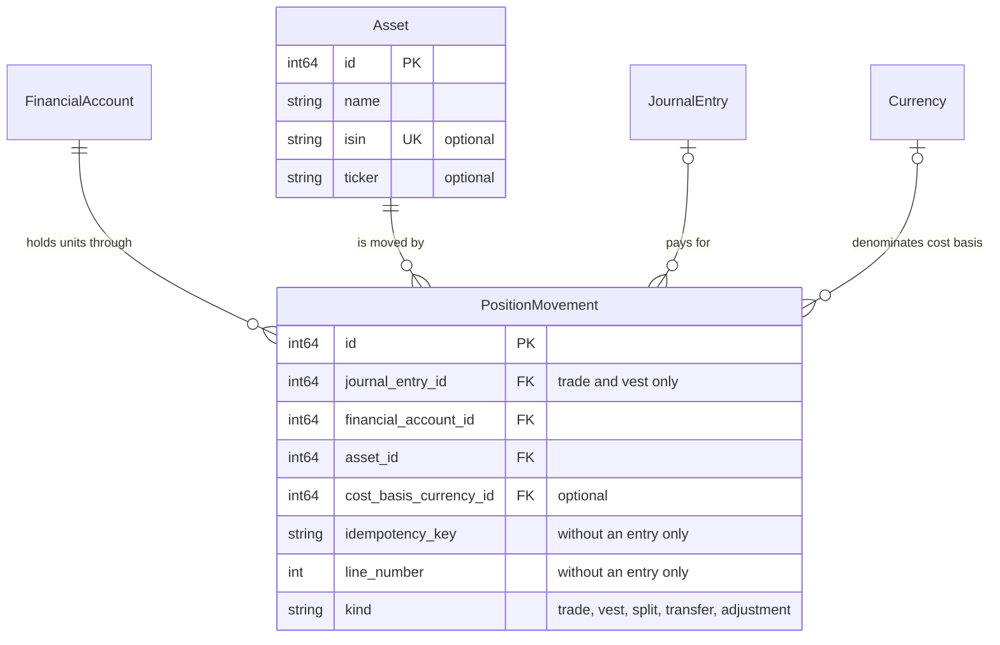
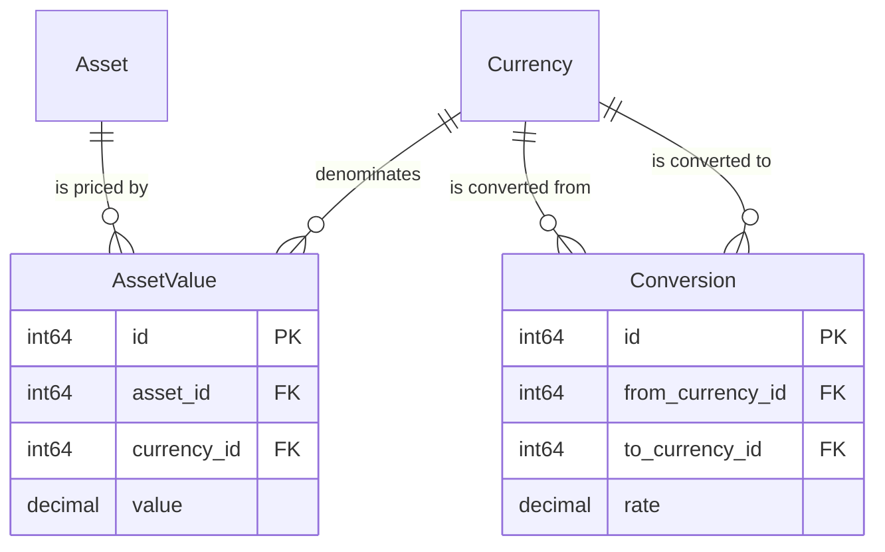

# How the entities relate

This page maps every persisted entity and the references between them, as they
are in `pkg/model` and the constraints installed by `pkg/sqllib`. It is the
structural companion to [the ledger model, in practice](ledger_examples.md),
which walks through what the entities mean with worked examples.

## At a glance

One person's setup, as the model sees it:

```text
Institution: Revolut
├── FinancialAccount: Revolut Personal
│   ├── LedgerAccount: Cash                (asset, EUR)
│   ├── LedgerAccount: Savings vault       (asset, EUR)
│   └── LedgerAccount: Cash                (asset, USD)
├── FinancialAccount: Revolut Joint
│   └── LedgerAccount: Cash                (asset, EUR)
└── FinancialAccount: Revolut Business
    └── LedgerAccount: Cash                (asset, GBP)

Institution: Amex
└── FinancialAccount: Amex Gold
    └── LedgerAccount: Card balance        (liability, EUR)

Institution: Interactive Brokers
└── FinancialAccount: IBKR
    ├── LedgerAccount: Cash                (asset, EUR)
    ├── LedgerAccount: Investments         (asset, EUR)
    ├── LedgerAccount: Cash                (asset, USD)
    ├── LedgerAccount: Investments         (asset, USD)
    └── units of AAPL, VWCE, ...           (position movements, not ledger accounts)

Institution: Physical cash
└── FinancialAccount: Wallet
    └── LedgerAccount: Cash                (asset, EUR)

No institution, no financial account:
├── LedgerAccount: Food                    (expense, EUR)
│   └── LedgerAccount: Groceries           (expense, EUR)
├── LedgerAccount: Salary                  (income, EUR)
├── LedgerAccount: Opening balances        (equity, EUR)
├── LedgerAccount: Opening balances        (equity, USD)
├── LedgerAccount: FX clearing             (asset, EUR)
└── LedgerAccount: FX clearing             (asset, USD)
```

- An **institution** is who you deal with; a **financial account** is one
  relationship with it (personal, joint, business, a card, a brokerage
  account); a **ledger account** is one balance in one currency.
- A financial account may hold several currencies, and several balances in the
  same currency when the money is kept apart, like a savings vault.
- A ledger account's name only has to make sense within its financial account
  and currency: "Cash" appears several times above, and each is a different
  balance. A top-level account is unique by its name, kind, and currency, so
  each currency has its own "Opening balances" and "FX clearing".
- Shares are not a balance: units of an asset are held by the financial account
  itself, through position movements.
- Categories, equity, and clearing accounts belong to no institution. Categories
  nest under another category of the same kind and currency, at most three
  levels deep (Food > Groceries > Supermarket).
- This is the structure the account setup facade creates
  ([ADR 0006](../adrs/0006-intent-level-account-setup.md)): `OpenAccount` gives
  a bank or cash account "Cash", a card "Card balance", and a brokerage "Cash"
  and "Investments" in each of its currencies, with the shared "Opening
  balances" and "FX clearing" of each currency. `AddBalance` adds the others,
  such as a savings vault. A wallet belongs to the institution "Physical
  cash", which is created on first use.

## The diagrams

The model is split into four diagrams, one per concern, so that no single
picture has every line crossing every other. An entity that appears in more
than one diagram has its fields listed only in the first. Only identifiers,
references, and fields that take part in a rule are shown: `PK` is the primary
key, `FK` a foreign key, and `UK` a field that is unique on its own.

## Accounts: where the money is



Only a `LedgerAccount` has a balance, and it is always in exactly one currency.
A `FinancialAccount` is a relationship with an `Institution`, such as "my
Revolut account", and has no currency and no balance of its own. It groups the
ledger accounts that belong to it, which is how one Revolut account holds a EUR
balance and a USD balance at the same time: two ledger accounts under one
financial account.

`financial_account_id` is optional. Categories (income and expense accounts
such as "Groceries"), equity accounts, and clearing accounts belong to no
institution, so they have none.

A ledger account may have a parent ledger account, which is how categories
like "Food > Groceries" are built. The hierarchy is at most two parent links
deep, and a parent has the same kind and currency as its children.

## Money movements



A `JournalEntry` is one financial event. Once posted it has at least two
`Posting` rows, each a debit or a credit on one ledger account, and they
balance per currency. A counterparty is optional descriptive metadata on the
entry, not an account, and deleting one leaves its entries in place without it.
A correction deletes the entry and records it again
([ADR 0011](../adrs/0011-deleting-journal-entries.md)). Reversing entries were
removed, and editing in place is decided but not built yet
([ADR 0017](../adrs/0017-editing-journal-entries.md)).

## Units of an asset



A `PositionMovement` records a change in how many units of an `Asset` a
`FinancialAccount` holds. Units belong to the financial account rather than to
a ledger account, because a holding of shares is not a currency balance. A
trade or a vest has a journal entry for its cash side; a split, a transfer, or
an adjustment has none, and carries its own idempotency key and line number
instead.

## Valuation reference data



`AssetValue` (a market price of an asset) and `Conversion` (an observed exchange
rate) are reference data for valuation. No posting or movement refers to them.

`Tag` is left out of every diagram: it is flat reference data with a unique
`name` and no reference to or from any other entity yet.

## Uniqueness today

These are all the uniqueness rules the database enforces:

| Entity | Unique |
|---|---|
| `Institution` | `name` |
| `Currency` | `code`, and `name` |
| `Counterparty` | `name` |
| `Asset` | `isin`, when present |
| `Tag` | `name` |
| `JournalEntry` | `idempotency_key`, when present |
| `Posting` | `(journal_entry_id, line_number)` |
| `PositionMovement` | `(idempotency_key, line_number)` |

`FinancialAccount`, `LedgerAccount`, `AssetValue`, and `Conversion` have no
uniqueness rule beyond their ID.
